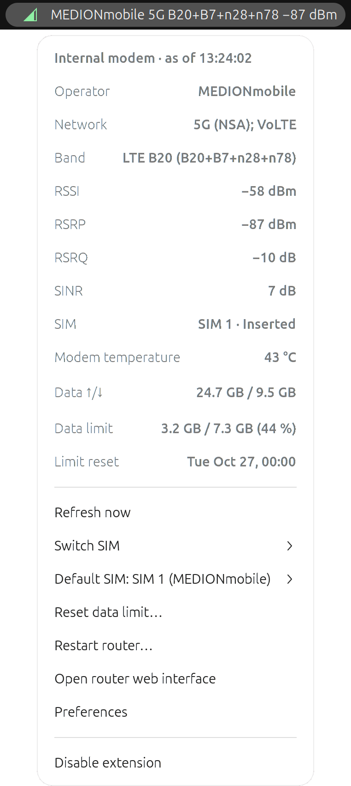
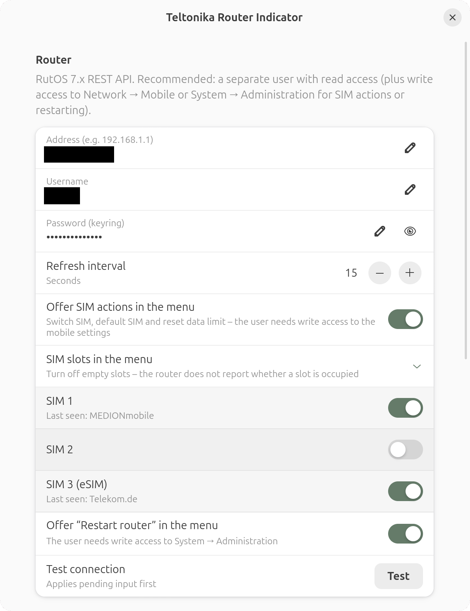

# Teltonika Router Indicator

**English** · [Deutsch](README.de.md)

GNOME Shell extension (GNOME 48–50) that shows the cellular status of a Teltonika router
running RutOS 7.x in the top bar, e.g. `5G B3+B20+n78 −95 dBm`.
The icon is colored by signal quality. The popup shows operator, network, band,
RSSI/RSRP/RSRQ/SINR, SIM, modem temperature and data counters.

<p>
  
  
</p>

Status: **v1.0**, tested with a Teltonika RUTM30 (RutOS 7.x) and against a mock router.
API notes: [docs/API.md](docs/API.md) (German).

## Installation

```bash
make install          # packs and installs to ~/.local/share/gnome-shell/extensions,
                      # plus launcher + icon in ~/.local/share/applications and icons
# Wayland: log out and back in once
gnome-extensions enable teltonika-indicator@stiefenm.github.io
gnome-extensions prefs teltonika-indicator@stiefenm.github.io
```

`make install` needs `gettext` to compile the translations.

In the preferences, enter the router address, username and password, then click “Test”.
For a self-signed certificate (the RutOS default), “Test” shows the SHA-256 fingerprint
and pins it only after you confirm it – until then no password is sent and the extension does not poll.
The password is stored in the GNOME keyring. A separate RutOS user with read access is recommended.
The optional SIM actions in the menu (setting “Offer SIM actions in the menu”: switch SIM,
default SIM, reset data limit) additionally need write access to the mobile settings.
“Restart router” (separate setting) needs write access to System → Administration.

## How it works

- RutOS REST API: `POST /api/login` gets a token, `GET /api/modems/status` the values.
  The token is renewed shortly before it expires or after a 401.
- Always HTTPS: an `http://` address is switched to `https://`, redirects are not followed.
- Self-signed certificate: the SHA-256 fingerprint is pinned only after confirmation in the preferences.
  If it changes, the connection is blocked until the new certificate is confirmed via “Test”.
  A new router address clears the pin. Certificates trusted by the system need no pin.
- If the router is unreachable, the polling interval is quietly extended (exponential backoff up to 5 min).
  On a wrong password or certificate problems, polling stops (one notification) until the
  preferences change – so it does not trigger the router's brute-force lockout.
- Router responses are limited to 1 MiB and 30 s per request.
- With several modems, the first one with signal is shown; a SIM switch always affects the selected modem.
- Switch SIM (submenu, after confirmation): `switch_sim` (“next SIM”), repeated if necessary until the target SIM
  is active – also across empty slots. The default SIM stays unchanged.
- The API reports the operator only for the active SIM. The last seen operator of each SIM is remembered
  and shown in the SIM menus, e.g. `SIM 3 (eSIM 1, MEDIONmobile)`. A SIM that was never active shows none.
- Set default SIM (separate submenu): only changes the configuration, the active connection stays up.
- Data limit (Network → Mobile → Limits on the router): the popup shows usage/limit of the active SIM and the next
  automatic reset. A warning icon appears in the top bar, yellow from the warning threshold (default 80 %, adjustable),
  red when the limit is used up, plus one notification per level. The SIM switch menu shows the usage
  of the other SIMs. “Reset data limit…” (after confirmation) sets the counter of the active SIM to 0;
  it is enabled together with SIM switching and needs the same write access.
- “Restart router…” (setting “Offer ‘Restart router’ in the menu”, after confirmation):
  `POST /api/system/actions/reboot`. The next poll follows after 60 s, then the normal backoff applies.
  The API offers no way to shut the router down.
- “Disable extension” in the menu turns the extension off (stays off after logging in again).
  Turn it back on in the Extensions app or – when installed via `make install` – with the
  “Teltonika Indicator” launcher in the app overview (runs `gnome-extensions enable …`).
- Empty slots can be hidden in the preferences, because the API does not report whether a slot is occupied.
- Language: follows the system language. German is translated, all other languages see English.

## Translations

Source strings are English, translations live in `po/`. To add a language, copy
`po/teltonika-indicator.pot` to `po/<lang>.po` (e.g. with `msginit`) and translate it.
After changing strings in the code, `make po` updates the template and translations.
`make pack` compiles them into the package (requires `gettext`).

## Development

```
extension.js      panel indicator, popup, polling/backoff
prefs.js          Adw preferences incl. connection test
lib/client.js     Soup 3 client: login, token, certificate pinning
lib/parse.js      normalization/formatting (pure functions)
lib/secret.js     libsecret wrapper
lib/i18n.js       gettext for lib/ (shell and preferences)
po/               translations (make po)
test/             parser tests, mock router, client tests
scripts/capture-fixtures.sh   save real router responses (masked) as fixtures
```

```bash
make test         # parser and translation tests + client against the mock router (HTTP and HTTPS)
journalctl -f -o cat /usr/bin/gnome-shell | grep -i teltonika
```

Code comments are in German.

## License

GPL-2.0-or-later, see [LICENSE](LICENSE).
